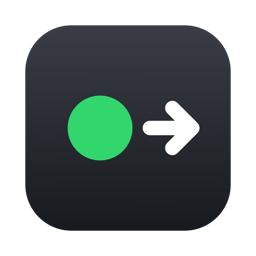
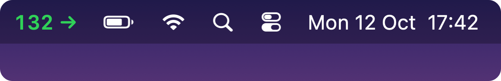
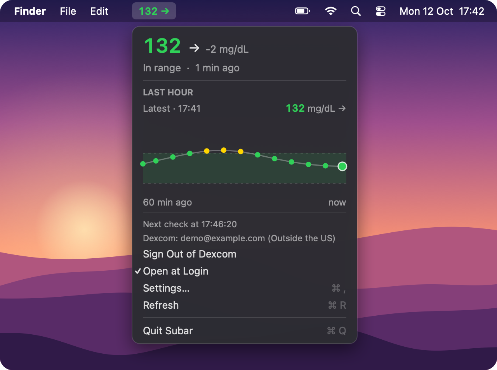
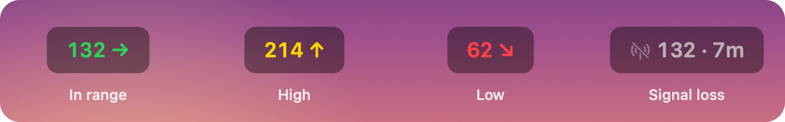
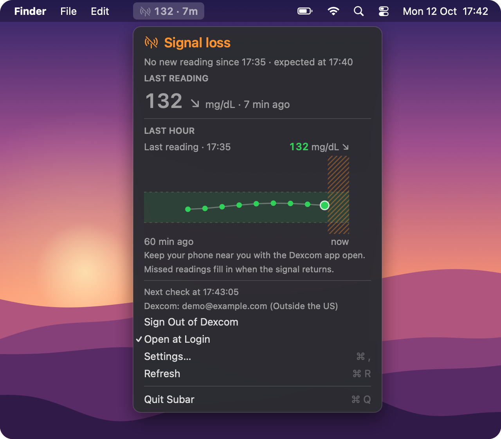

# Subar

**Your Dexcom glucose in the macOS menu bar.**

Subar shows your latest reading and trend arrow in the menu bar, colored by range. Click it for the details and a graph of the last hour. It reads from **Dexcom Share**, the service behind the Dexcom Follow app.

> **Not a medical device.** Subar is unofficial and not affiliated with Dexcom. Readings can be delayed or missing. Always use your Dexcom app or receiver for alerts and treatment decisions.

## Install

1. Download **`Subar-<version>.pkg`** from the [latest release](https://github.com/yuvalezrati/subar/releases/latest) and double-click it.
2. macOS blocks it the first time, because Subar isn't signed with a paid Apple Developer ID. Click **Done**, open **System Settings → Privacy & Security**, scroll down and click **Open Anyway**.
3. Subar opens in the menu bar with a sign-in panel. Enter your Dexcom username and password, choose your region and click **Sign In**.

**Before you start:** turn on **Share** in the Dexcom app and invite at least one follower (it can be yourself on a second email address). Subar needs macOS 12 or later.

To update, install the newer `.pkg`; you stay signed in. To uninstall, quit Subar and drag it from Applications to the Trash.

## What you see

Green is in range (70–180 mg/dL by default), yellow is high and red is low. A hollow gray circle means you're not signed in.

When a reading is late, Subar shows **Signal loss** with the last value and its age, instead of passing off an old number as live:

These pictures are drawn by Subar's own code with demo readings, on an illustrated desktop.

## Settings

Choose **Settings…** from the menu to edit `config.json`. Changes apply on the next refresh.

| Setting | Default | Options |
|---|---|---|
| `menuBarStyle` | `"number"` | `"number"`, `"dotNumber"` (dot and number) or `"dot"` (dot only) |
| `units` | `"mg/dL"` | `"mg/dL"` or `"mmol/L"` |
| `low` / `high` | `70` / `180` | Your target range, in mg/dL |
| `urgentLow` / `urgentHigh` | `55` / `250` | Labeled "URGENT" in the menu |

## Privacy

Your password is stored only in your Mac's Keychain, and Subar talks only to Dexcom's Share servers. **Sign Out of Dexcom** in the menu removes the saved password. If Dexcom rejects the password, Subar stops trying so your account doesn't get locked.

## Troubleshooting

- **Wrong username or password.** Check the region first: accounts registered outside the US must use "Outside the US".
- **Signed in, but no readings.** Make sure Share is on in the Dexcom app with at least one follower.
- **Nothing in the menu bar.** On MacBooks with a notch, extra items can hide behind it. Quit a few other menu bar apps.

## License

[MIT](LICENSE). Developers: see [scripts/](scripts/) to build Subar from source.
