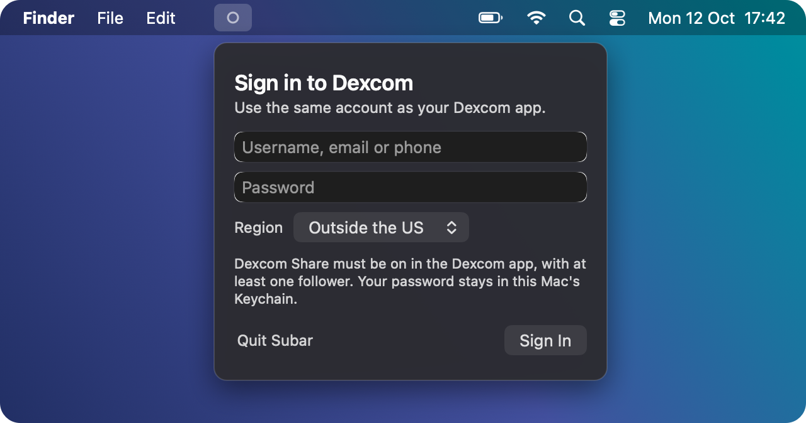

<div align="center">


# Subar

**Your Dexcom glucose in the macOS menu bar.**

[](https://github.com/yuvalezrati/subar/releases/latest)


[](LICENSE)


</div>

Subar shows your latest reading and trend arrow in the menu bar, colored by range. Click it to see the details and a graph of the last hour. It reads from **Dexcom Share**, the same service the Dexcom Follow app uses, so it works with the official Dexcom app and with Loop.

```bash
curl -fsSL https://raw.githubusercontent.com/yuvalezrati/subar/main/get-subar.sh | bash
```

> **Not a medical device.** Subar is an unofficial tool that isn't affiliated with Dexcom. Readings can be delayed or missing. Always use your Dexcom app or receiver for alerts and treatment decisions.

## What you see

<p align="center"></p>

| Menu bar | Meaning |
|---|---|
| `132 →` in **green** | In range (70–180 mg/dL by default) |
| `214 ↑` in **yellow** | High |
| `62 ↘` in **red** | Low |
| Gray antenna icon + `132 · 7m` | **Signal loss.** The next reading was due but didn't arrive, so this is the last value and its age |
| Hollow gray circle | Not signed in. Click it to sign in |

Click the menu bar item to see:

- The current reading, trend arrow and change since the last reading
- A **Last hour** graph. Hover over any dot to see that reading's time, value and trend
- When the next check will happen, your Dexcom account, Sign Out, Settings, Refresh and Quit

When a reading is late, Subar says so instead of showing a stale number as if it were live:

<p align="center"></p>

<sub>The pictures on this page are drawn by Subar's own code with demo readings, on an illustrated desktop.</sub>

## Install

**The quick way:** open **Terminal**, paste this line and press Return:

```bash
curl -fsSL https://raw.githubusercontent.com/yuvalezrati/subar/main/get-subar.sh | bash
```

It downloads the latest release, puts **Subar.app** in Applications and opens it. There's no security warning this way.

**The installer:**

1. Download **`Subar-<version>.pkg`** from the [latest release](https://github.com/yuvalezrati/subar/releases/latest).
2. Double-click it and click through the installer. If macOS blocks it, see the warning section below.
3. Subar installs into **Applications** and opens.

<p align="center"></p>

**Then sign in:** a **Sign in to Dexcom** panel opens under the menu bar item. Enter your Dexcom username (or email or phone) and password, choose your **region** (United States, Outside the US or Japan), and click **Sign In**.

Your reading appears within a few seconds. Subar opens automatically when you log in. You can turn that off with **Open at Login** in its menu.

**Before you start:** turn on **Share** in the Dexcom app and invite at least one follower. You can invite yourself on a second email address. Subar needs macOS 12 or later. Open at Login needs macOS 13 or later.

### "Apple could not verify…" warning

If the installer wasn't signed with an Apple Developer ID, macOS blocks it the first time:

1. Double-click the `.pkg`, then click **Done** (or **OK**) on the warning.
2. Open **System Settings → Privacy & Security** and scroll down.
3. Next to *"Subar-….pkg" was blocked*, click **Open Anyway**, then confirm.

You only need to do this once.

**Alternative:** download the `.zip`, unzip it and drag **Subar.app** into Applications. The same warning applies the first time you open the app.

### Update or uninstall

- **Update:** run the Terminal line again, or install the newer `.pkg`. Either one quits Subar, replaces the old version and reopens it. You stay signed in.
- **Uninstall:** quit Subar from its menu and drag **Subar.app** from Applications to the Trash. To also remove your settings, delete `~/Library/Application Support/Subar`. To remove the saved password, use **Sign Out of Dexcom** before uninstalling.

## Your account and privacy

- No credentials are built into Subar. Each person signs in with their own Dexcom account on their own Mac.
- The password is stored in that Mac's **Keychain**. The username and region are stored in the settings file.
- Subar only talks to Dexcom's Share servers. It doesn't send data anywhere else.
- **Sign Out of Dexcom** in the menu removes the saved password.
- If Dexcom rejects the saved password, for example after you change it, Subar stops trying so your account doesn't get locked, and asks you to sign in again.

After an update or a rebuild, macOS may ask whether Subar can use its saved Keychain item. Click **Always Allow**.

## How updates are timed

Dexcom sensors send a reading every 5 minutes. Instead of checking constantly, Subar checks right after each reading is due, which saves battery. That's 5 minutes and 20 seconds after the previous reading.

- If the reading isn't there yet, Subar shows **Signal loss** and checks again after 30 seconds, then 1, 2 and 4 minutes, then every 5 minutes until readings resume.
- When your Mac wakes from sleep, Subar checks immediately.
- If your Mac is offline, the menu says it couldn't reach Dexcom. That's different from signal loss, which means Dexcom has no new reading.

## Settings

Choose **Settings…** (⌘,) from the menu to open `~/Library/Application Support/Subar/config.json`. Changes apply on the next refresh (⌘R) with no rebuild needed.

| Setting | Default | Options |
|---|---|---|
| `menuBarStyle` | `"number"` | `"number"` (colored `132 →`), `"dotNumber"` (`● 132 →`), `"dot"` (colored dot only) |
| `units` | `"mg/dL"` | `"mg/dL"` or `"mmol/L"` |
| `low` / `high` | `70` / `180` | Your target range, always in mg/dL |
| `urgentLow` / `urgentHigh` | `55` / `250` | Labeled "URGENT" in the menu |
| `dexcomRegion` | `"ous"` | Set by the sign-in panel: `"us"`, `"ous"` or `"jp"` |

## Troubleshooting

- **The sign-in panel says the username or password is wrong.** Check the region first, since accounts registered outside the US must use "Outside the US". Then try your username exactly as you use it in the Dexcom app.
- **Signed in, but there are no readings.** Make sure Share is on in the Dexcom app with at least one follower, and that your phone has internet access.
- **Nothing appears in the menu bar.** On MacBooks with a notch, extra menu bar items can hide behind it. Quit a few other menu bar apps, or check **System Settings → Menu Bar**. To confirm Subar is running, use `pgrep -l Subar`.
- **Build errors.** Make sure the Command Line Tools are installed (`xcode-select --install`), and that `subar.swift` is in the same folder as the build scripts.

## Building it yourself

You need Xcode Command Line Tools, which you can install with `xcode-select --install`.

| Command | What it does |
|---|---|
| `./build-app.sh` | Builds the release into `dist/`: the `.pkg` installer, a `.zip` and `Subar.app`. The app runs on both Apple silicon and Intel Macs |
| `VERSION=1.1.0 ./build-app.sh` | Same, with a version number |
| `./install.sh` | Developer build: compiles and runs Subar straight from `subar.swift`, restarting it after each change |

**Publishing a release:** push a version tag and GitHub Actions builds it and publishes the `.pkg` and `.zip` on the Releases page:

```bash
git tag v1.1.0 && git push origin v1.1.0
```

**Avoiding the security warning:** with an Apple Developer account, macOS opens the installer with no warning. The account costs $99 a year. You need a *Developer ID Application* certificate and a *Developer ID Installer* certificate. Create a notarization profile once with `xcrun notarytool store-credentials subar-notary`, then run:

```bash
DEVELOPER_ID="Developer ID Application: Your Name (TEAMID)" \
INSTALLER_ID="Developer ID Installer: Your Name (TEAMID)" \
NOTARY_PROFILE="subar-notary" ./build-app.sh
```

## Files

| File | What it is |
|---|---|
| `subar.swift` | The whole app: one Swift file using only macOS frameworks |
| `build-app.sh` | Builds the downloadable installer (`.pkg`), `.zip` and `Subar.app` |
| `install.sh` | Developer build that runs from `~/Applications/Subar/Subar` and starts at login |
| `get-subar.sh` | The one-line installer: downloads the latest release into Applications |
| `.github/workflows/release.yml` | Builds and publishes a release when a version tag is pushed |
| `~/Library/Application Support/Subar/config.json` | Your settings |
| `~/Library/LaunchAgents/local.subar.plist` | Starts the developer build at login (`install.sh` only) |

## License

[MIT](LICENSE)
